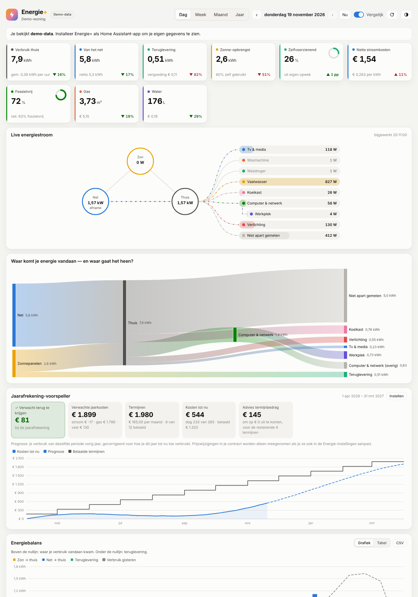

# Energie+ for Home Assistant

An **extra**, more detailed and more visual energy dashboard for Home Assistant — installed
as a Home Assistant app (add-on) with its own sidebar panel. It sits next to the built-in
Energy dashboard and reuses its configuration; nothing is replaced or changed.



## Installation

### Option A — via a GitHub repository (recommended)

1. In Home Assistant: **Settings → Apps (Add-ons) → App store → ⋮ → Repositories**, add
   `https://github.com/martijntalens/EnergyPlus`.
2. Install **Energie+**, start it and enable **Show in sidebar**.

### Option B — local app

1. Copy the `energy_plus` folder to the `/addons` share of your Home Assistant
   (e.g. via the *Samba share* or *Advanced SSH & Web Terminal* app).
2. **Settings → Apps → App store → ⋮ → Check for updates**. Energie+ appears under
   *Local apps*.
3. Install, start, enable **Show in sidebar**.

Requirements: Home Assistant OS or Supervised (apps need the Supervisor), the Energy
dashboard configured, amd64 or aarch64.

## Try it without Home Assistant

```bash
cd energy_plus/rootfs/app
DEMO=1 node server.mjs      # Node 22+, no dependencies
# open http://localhost:8099/?demo
```

Demo mode shows a synthetic Dutch household (solar, home battery, EV charger, gas, water).

## Structure

```
repository.yaml               App repository metadata
energy_plus/
  config.yaml                 App manifest (ingress, panel, options)
  build.yaml / Dockerfile     Alpine base image + Node.js
  DOCS.md                     Documentation shown in Home Assistant
  rootfs/run.sh               Entry point
  rootfs/app/server.mjs       Read-only API relay + static server (no npm deps)
  rootfs/app/www/             Dashboard (vanilla JS + bundled ECharts 5.5.1)
```

See [energy_plus/DOCS.md](energy_plus/DOCS.md) for features, options and security notes.

## License

MIT. Bundled Apache ECharts is licensed under Apache-2.0 (see `www/vendor/ECHARTS-LICENSE`).
